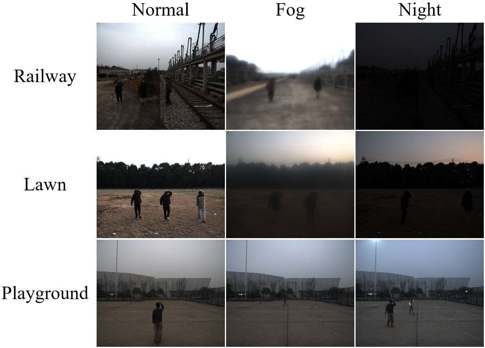
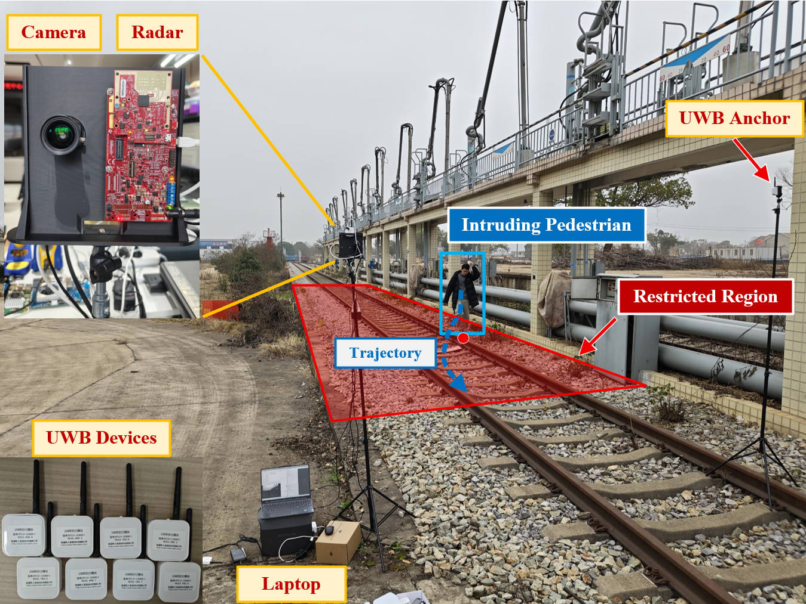
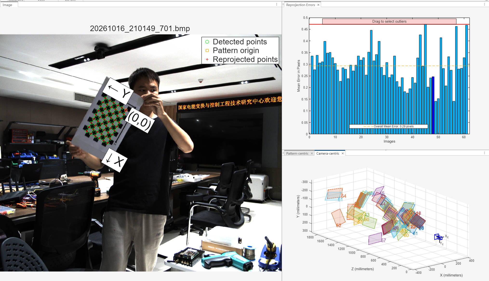
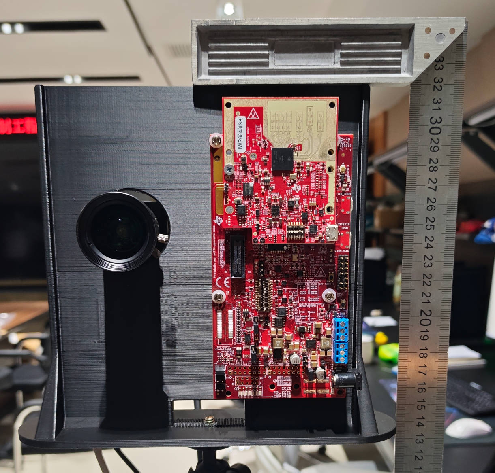
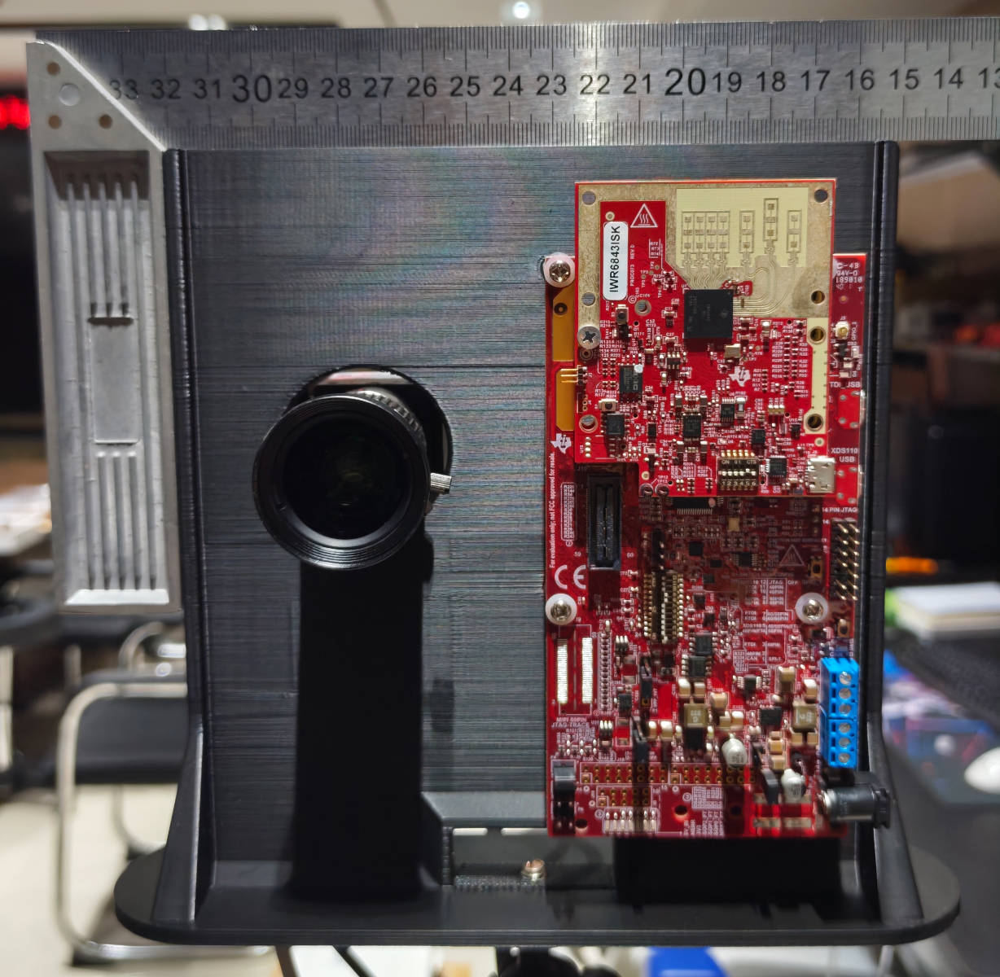

<div align="center">
<h1>RaVITD</h1>

<p><strong>Radar–Vision Intrusion Toolkit and Dataset</strong></p>

<h3>
From Image-Defined Regions to Metric Boundaries:<br>
Radar–Vision Fusion for Railway Pedestrian Intrusion Monitoring Under Degraded Visibility
</h3>
<p>
Yaoyu Jiang ,  Quan Zhou ,  Zijun Long ,  Hao Wang<br>
Xiaoguang Wei ,  Mohammad Shahidehpour
</p>
<p>
  <a href="https://github.com/ChiangJYY/Radar-Vision-Fusion">
    
  </a>
  <a href="#公开数据集-ravid">
    
  </a>
  <a href="mailto:yaoyujiang@hnu.edu.cn">
    
  </a>
</p>
</div>

---


## 目录

- [概述](#概述)
- [项目结构](#项目结构)
- [公开源码 RaVIT](#公开源码-ravit)：[安装](#安装) · [配置](#配置) · [运行方法](#运行方法)
- [公开数据集 RaVID](#公开数据集-ravid)
  - [数据概况](#数据概况) · [数据格式](#数据格式) · [传感器介绍](#传感器介绍)
  - [时空对齐与标定](#时空对齐与标定) · [下载与储存](#下载与储存) · [评价协议](#评价协议)
- [致谢与许可](#致谢与许可)
- [论文与引用](#论文与引用)

## 概述

**RaVIT（Radar–Vision Intrusion Toolkit）** 面向低能见度条件下的铁路行人入侵监测，公开 **ECDR-GAT** 区域边界重建、**Trans-DKF** 自适应雷达视觉融合，以及数据读取、标定、多目标跟踪、区域关系判断和评测工具。

配套公开数据集 **RaVID（Radar–Vision Intrusion Dataset）** 包含操场、草地和铁路场景的摄像头、雷达、UWB 记录，另提供标定相关文件与传感器数据采集工具。原始数据通过邮件联系申请获取。

## 项目结构

```text
├── src/
│   ├── radar_vision_fusion/   # 核心方法、感知、标定、跟踪和评测
│   └── third_party/          # RT-DETR、Depth Anything V2 源码子集
├── scripts/                  # 数据转换、标定、推理、评测及绘图
├── tools/                    # 传感器采集工具
├── configs/                  # 推理配置与标定模板
├── dataset/                  # RaVID 数据存放位置
├── figures/                  # 场景、相机标定过程与设备尺度图片
├── docs/                     # 附加文档
├── requirements.txt
└── pyproject.toml
```

## 公开源码 RaVIT

**RaVIT — Radar–Vision Intrusion Toolkit**

### 安装
提供网络结构、特征构造、归一化接口、滤波公式、损失函数，以及视觉观测、标定、跟踪、基线和评测工具。建议 Python 3.10+。在仓库根目录创建并激活独立环境，在该环境中安装与本机 CPU/CUDA 匹配的 PyTorch 和 torchvision，再安装项目依赖：

```bash
python -m venv .venv
# Windows PowerShell: .\.venv\Scripts\Activate.ps1
# Linux/macOS: source .venv/bin/activate
# 激活后，先按本机 CPU/CUDA 环境安装匹配的 PyTorch 和 torchvision。
python -m pip install -r requirements.txt
python -m pip install -e . --no-deps
```

仅使用核心算法时可直接运行 `python -m pip install -e .`。`requirements.txt` 给出版本下限，并非固定环境；工业相机还需单独安装驱动与 海康威视 MVS SDK。

### 配置

| 配置或输入 | 使用说明 |
| --- | --- |
| `configs/inference.json` | 跟踪模式、噪声、关联及事件参数；区域通过 `--region-file` 指定，或填写 `region` |
| `configs/calibration.template.json` | 复制到自选位置，填写实测相机内参和 `camera_from_radar` 外参 |
| `configs/rtdetrv2_r50vd_m.yml` | 默认 RT-DETRv2 结构配置 |
| 模型权重与输出 | 分别通过 `--checkpoint` 等参数和 `--output` 指定 |

### 运行方法

在仓库根目录执行，尖括号内容替换为实际路径。输入数据、区域和标定需由使用者提供，输出位置通过参数指定。

#### 区域重建与融合跟踪

```bash
# ECDR-GAT：边界观测 CSV 列为 u,v,z_raw，输出 JSON 包含 region 四角点
python scripts/run_boundary.py --input <boundary.csv> --checkpoint <ecdr.pt> --calibration <calibration.json> --output <boundary.json>

# Trans-DKF 融合跟踪与越界监测
python scripts/run_inference.py --input <detections.json> --region-file <boundary.json> --mode learned --checkpoint <transdkf.pt> --output <tracks.json>

# 基础跟踪：不需要学习模型权重；使用自己提供的区域
python scripts/run_inference.py --input <detections.json> --region-file <region.json> --mode fixed --output <tracks_fixed.json>
```

#### 结果评测与绘图

```bash
python scripts/evaluate_results.py --task boundary --prediction <boundary.json> --reference <reference_region.json> --output <boundary_metrics.json>
python scripts/evaluate_results.py --task tracking --prediction <tracks.json> --reference <reference_tracks.json> --output <tracking_metrics.json>
python scripts/plot_results.py --input <tracks.json> --output <tracking.png>
```

评测提供参考区域或轨迹，预测与参考帧时间需一致。其余入口如下：

| 脚本 | 用途 |
| --- | --- |
| `run_visual.py` | RT-DETRv2 与度量 Depth Anything V2 生成视觉观测 |
| `prepare_sequence.py` | 相机与雷达数据转换、时间对齐 |
| `calibrate_extrinsics.py` | 雷达与相机外参标定 |
| `evaluate_results.py` | 区域与跟踪评测，需提供参考真值 |
| `plot_results.py` | 结果绘图 |

## 公开数据集 RaVID

**RaVID — Radar–Vision Intrusion Dataset**

### 数据概况

RaVID 提供摄像头图像、毫米波雷达点云及设备跟踪输出、UWB 行人真实地面轨迹日志，覆盖操场、草地和铁路场景中的单人、多人、雾天、夜间及边界行走工况。

当前数据包总容量为 **1.02 TB**，包含 **13 个工况目录、67,864 张场景 BMP 图像**，另有 **66 张相机标定照片**及标定靶、MATLAB 标定参数文件。

<p align="center">
  
</p>

操场、草地和铁路场地与能见度示例，包含单人、多人、雾天、夜间及边界行走工况。

### 采集平台

| 设备 | 配置与作用 |
| --- | --- |
| 毫米波雷达 | Texas Instruments IWR6843，提供点云及目标位置、速度等观测 |
| 工业相机 | 海康机器人 MV-CS050-10UC，彩色图像，2448 × 2048 |
| 相机镜头 | MVL-MF0824M-5MPE，8 mm 固定焦距 |
| 安装方式 | 相机与雷达固定安装，距地面约 2 m，视场重叠 |
| UWB 参考系统 | 使用五个预标定基站及行人携带的定位标签提供行人地面真实轨迹 |

相机与雷达采集频率均为 **10 Hz**，UWB 参考定位频率为 **5 Hz**。各传感器记录保留时间戳，采集后根据时间戳进行数据帧时间对齐；

<p align="center">
  
</p>
铁路场景中的采集平台与入侵监测示意。图中展示相机、毫米波雷达、UWB 设备及基站布置；禁入区域与行人运动轨迹为示意标注。

### 场景组织

数据按“采集批次与场地 -工况 -传感器记录”组织，当前目录名称如下：

| 场景目录 | 工况目录 | 图像数 |
| --- | --- | ---: |
| `0118_playground` | `single_person_normal`、`two_person_normal` | 8,838 |
| `0122_lawn` | `single_person_normal`、`two_person_normal`、`three_person_normal`、`two_person_fog`、`two_person_night` | 31,925 |
| `0129_railway` | `single_person_boundary`、`single_person_fog`、`single_person_night`、`two_person_normal`、`three_person_normal`、`two_person_fog` | 27,101 |

`single_person`、`two_person`、`three_person` 分别表示单人、双人和三人工况；`normal`、`fog`、`night`、`boundary` 分别表示常规、雾天、夜间和边界行走。

### 目录结构

获取数据后可保留原结构，放入 `dataset/` 或使用外部路径。以下以铁路单人边界工况为例：

```text
dataset/
├── camera_calibration/
│   ├── calibration_images/                 # 相机标定照片
│   ├── checkerboardPattern_side_length_23mm.pdf
│   └── matlab.mat                         # MATLAB 标定结果
├── 0118_playground/
├── 0122_lawn/
└── 0129_railway/
    └── single_person_boundary/
        ├── cam/YYYYMMDD_HHMMSS/
        │   └── YYYYMMDD_HHMMSS_mmm.bmp
        ├── radar/
        │   └── LRPD_data_YYYYMMDD_HHMMSS.txt
        └── uwb/
            ├── YYYYMMDD_HHMMSSRTLS1_log.txt
            ├── YYYYMMDD_HHMMSS_RTLS1_Tag<N>_log.csv
            └── YYYYMMDD_HHMMSSRTLS_log_dbg.txt
```

`cam/` 保存图像，`radar/` 保存点云及聚类跟踪结果，`uwb/` 保存参考定位和测距日志，同一工况可能包含多次采集及多个日志文件。

### 数据格式

<details>
<summary>展开查看相机、雷达和 UWB 的文件字段</summary>
#### 相机图像

相机图像按采集会话保存，典型路径为：

```text
cam/YYYYMMDD_HHMMSS/YYYYMMDD_HHMMSS_mmm.bmp
```

| 项目         | 数据形式或数值            | 说明                                   |
| ------------ | ------------------------- | -------------------------------------- |
| 文件格式     | BMP                       | 未压缩彩色图像                         |
| 图像分辨率   | 2448 × 2048               | 宽 × 高，单位为像素                    |
| 图像位深     | 24 bit                    | 三个颜色通道，每通道 8 bit             |
| 名义采集频率 | 10 Hz                     | 实际间隔以图像文件时间戳为准           |
| 会话目录     | `YYYYMMDD_HHMMSS/`        | 按采集会话建立的图像保存目录           |
| 文件名       | `YYYYMMDD_HHMMSS_mmm.bmp` | 包含图像记录日期、时间及毫秒部分       |
| `YYYYMMDD`   | 年、月、日                | 用于确定记录日期                       |
| `HHMMSS`     | 时、分、秒                | 用于确定记录时刻                       |
| `mmm`        | 毫秒部分                  | 三位数字，范围为 `000–999`             |
| 时间戳来源   | 采集电脑本地时钟          | 由图像采集回调生成，非硬件曝光起始时间 |

#### 雷达日志

TXT 提供处理后的逐帧点云及设备跟踪结果，不包含原始 ADC 波形。数据形式如下：

```text
Timestamp: YYYY-MM-DD HH:MM:SS.mmm, Frame: <帧号>, Points: <点数>, Tracks: <轨迹数>
Points (X,Y,Z,Doppler,SNR,Noise,TrackIndex):
Tracks (TID,X,Y,Z,Vx,Vy,Vz,Ax,Ay,Az,G,ConfidenceLevel):
```

| 类型 | 字段 |
| --- | --- |
| 帧头 | `Timestamp: YYYY-MM-DD HH:MM:SS.mmm, Frame: <帧号>, Points: <点数>, Tracks: <轨迹数>` |
| Points | `X,Y,Z,Doppler,SNR,Noise,TrackIndex` |
| Tracks | `TID,X,Y,Z,Vx,Vy,Vz,Ax,Ay,Az,G,ConfidenceLevel` |

**帧头字段**

| 字段        | 含义                             | 单位或说明                                |
| ----------- | -------------------------------- | ----------------------------------------- |
| `Timestamp` | 采集程序保存该帧时的电脑本地时间 | 日期与时间，记录至毫秒；非雷达 CPU 时间戳 |
| `Frame`     | 雷达输出的帧编号                 | 整数                                      |
| `Points`    | 当前帧检测点数量                 | 个                                        |
| `Tracks`    | 当前帧跟踪目标数量               | 个                                        |

**点云字段（Points）**

| 字段         | 含义                                 | 单位或说明     |
| ------------ | ------------------------------------ | -------------- |
| `X`          | 检测点的 X 坐标                      | m              |
| `Y`          | 检测点的 Y 坐标                      | m              |
| `Z`          | 检测点的 Z 坐标                      | m              |
| `Doppler`    | 检测点的径向速度                     | m/s            |
| `SNR`        | 检测点的信噪比                       | dB             |
| `Noise`      | 检测点对应的噪声指标                 | dB             |
| `TrackIndex` | 检测点关联的轨迹编号，或未关联状态码 | 整数，含特殊值 |

**TrackIndex 的常见取值**

| 取值    | 含义                                         |
| ------- | -------------------------------------------- |
| `0–249` | 正常轨迹编号范围，实际可用数量受跟踪配置限制 |
| `253`   | 信噪比过低，未关联到轨迹                     |
| `254`   | 位于关注边界之外，未关联到轨迹               |
| `255`   | 未关联到轨迹，被视为噪声                     |

**设备跟踪字段（Tracks）**

| 字段              | 含义                                                | 单位或说明                           |
| ----------------- | --------------------------------------------------- | ------------------------------------ |
| `TID`             | 跟踪目标的轨迹编号                                  | 整数                                 |
| `X`               | 跟踪器估计的目标 X 坐标                             | m                                    |
| `Y`               | 跟踪器估计的目标 Y 坐标                             | m                                    |
| `Z`               | 跟踪器估计的目标 Z 坐标                             | m                                    |
| `Vx`              | 目标沿 X 轴的估计速度                               | m/s                                  |
| `Vy`              | 目标沿 Y 轴的估计速度                               | m/s                                  |
| `Vz`              | 目标沿 Z 轴的估计速度                               | m/s                                  |
| `Ax`              | 目标沿 X 轴的估计加速度                             | m/s²                                 |
| `Ay`              | 目标沿 Y 轴的估计加速度                             | m/s²                                 |
| `Az`              | 目标沿 Z 轴的估计加速度                             | m/s²                                 |
| `G`               | 关联门控函数增益（Gating function gain）            | 无量纲，用于量测与轨迹的关联门控     |
| `ConfidenceLevel` | 设备跟踪器的置信度指标（Tracker confidence metric） | 无量纲，不直接解释为检测概率或百分比 |

每帧记录数可变；点数和轨迹数均为零时可能只有帧头，读取程序应允许空帧。

#### UWB TXT

UWB 主日志（`*RTLS1_log.txt`）逐行保存基站配置、标签到基站的测距及标签定位结果。数据形式如下：

```text
YYYY-MM-DD_HH:MM:SS:mmm HR-RTLS1 LogFile
HH:MM:SS:mmm Anchor<m>(x_a,y_a,z_a)
HH:MM:SS:mmm TAG<n>-ANC<m>=distance
HH:MM:SS:mmm TAG<n>[x_t,y_t,z_t]
```

定位无效时，日志中可能出现：

```text
HH:MM:SS:mmm TAG<n>[nan,nan,nan]
```

**记录类型**

| 类型     | 数据形式                                   | 内容                     |
| -------- | ------------------------------------------ | ------------------------ |
| 文件头   | `YYYY-MM-DD_HH:MM:SS:mmm HR-RTLS1 LogFile` | 日志日期时间及文件标识   |
| 基站配置 | `HH:MM:SS:mmm Anchor<m>(x_a,y_a,z_a)`      | 基站编号及配置坐标       |
| 测距记录 | `HH:MM:SS:mmm TAG<n>-ANC<m>=distance`      | 指定标签到指定基站的距离 |
| 定位记录 | `HH:MM:SS:mmm TAG<n>[x_t,y_t,z_t]`         | 指定标签的位置结果       |

**读取说明**

- 本数据集按测距值 **mm**、坐标值 **m** 解释，TXT 本身未逐项附带单位后缀。
- 日志可能列出 `Anchor0` 至 `Anchor7` 的配置，但不表示八个基站均参与定位，本实验使用五个基站。
- 测距与定位记录的时间戳可能存在少量差异，应按标签编号和时间匹配。
- 缺失的测距记录不能直接补为零，包含 `nan` 的定位结果不作为有效参考位置。
- 不能仅凭存在 `z_t` 字段就认定其为有效的三维高度测量。

#### UWB CSV

部分记录按标签提供 CSV，主要字段如下：

| 字段 | 含义或单位 |
| --- | --- |
| `rangetime(ms)` | 毫秒计时值 |
| `tag_ID` | 标签标识 |
| `x(m),y(m),z(m)` | 标签位置，米 |
| `range0(m)` 至 `range7(m)` | 到各基站的距离，米；部分值为 `null` |
| `rx_pwr(dBm)` | 接收功率，dBm |
| `accel_*`、`gyro_*`、`mag_*` | 预留惯性与磁场字段 |
| `roll,pitch,yaw` | 预留姿态字段 |

表头末尾可能存在空列；预留惯性及姿态字段中的零值不能视为有效测量。当前 CSV 文件名中的 `Tag1/Tag2/Tag3` 对应内容中的 `Tag 0/Tag 1/Tag 2`。

</details>

### 传感器介绍

#### 工业相机与采集工具

| 参数 | 规格 |
| --- | --- |
| 相机型号 | Hikrobot MV-CS050-10UC，彩色 |
| 传感器类型 | CMOS，全局快门 |
| 传感器型号 | Sony IMX264 |
| 像元尺寸 | 3.45 μm × 3.45 μm |
| 靶面尺寸 | 2/3 英寸 |
| 分辨率 | 2448 × 2048 |
| 厂家最大帧率 | 60 fps，限定 2448 × 2048、Bayer RG 8 |
| 镜头接口 | C-Mount |

**采集步骤**：

1. 我们提供的摄像头数据采集工具提供实时保存图片数据与可视化功能，首先安装海康机器人 MVS、相机驱动和 Python SDK，连接相机；核对 `tools/camera/camera.py` 中的 `sdk_path` 指向本机 SDK 的 `MvImport` 目录。脚本当前默认路径为 `D:\MVS\MVS\Development\Samples\Python\MvImport`。
2. 从仓库根目录打开终端，启动采集界面：

   ```powershell
   cd tools/camera
   python .\camera.py
   ```

3. 程序自动枚举并打开第一台可用相机，点击“开始”采集并保存；通过界面调整曝光。
4. 点击“停止”暂停保存，预览继续；再次点击“开始”会建立新的记录目录。

脚本默认设置为 **10 Hz、2448 × 2048、50 ms 曝光**，其中曝光可在界面调整。图像保存于启动目录下的 `YYYYMMDD_HHMMSS/`，文件名为 `YYYYMMDD_HHMMSS_mmm.bmp`；时间戳来自采集电脑本地时钟。

#### 相机镜头

| 参数 | 规格 |
| --- | --- |
| 型号 | Hikrobot MVL-MF0824M-5MPE |
| 焦距 | 8 mm，固定焦距 |
| F 数 | F2.4–F16，手动光圈 |
| 像面尺寸 | Φ11 mm（2/3 英寸） |
| TV 畸变 | −0.9%，厂家标称值 |
| 视场角 | 对角 D：70.6°（11.1 mm）；水平 H：56.4°（8.45 mm）；垂直 V：48.3°（7.07 mm） |
| 聚焦与接口 | 手动对焦，C-Mount |

#### 毫米波雷达与采集工具

采集使用 **TI mmWave Industrial Toolbox 4.12.1** 中 Long Range People Detection 的预编译固件：

```text
labs/Long_Range_People_Detection/prebuilt_binaries/long_range_people_det_6843_demo.bin
```

该工具包中的示例版本为 **Long Range People Detection 1.5.1**，6843 工程依赖 **mmWave SDK 03.05.00.04**。本文档引用固件来源，仓库不附带固件文件。对应配置为 [`6843_50m_2D.cfg`](tools/radar/Visualizer/chirp_configs/6843_50m_2D.cfg)。

| 参数 | 配置值及说明 |
| --- | --- |
| 雷达型号 / 起始频率 | IWR6843 / 60 GHz |
| 接收与发射通道 | 4 Rx；`channelCfg 15 7 0` 使能 3 Tx，当前两个 chirp 实际使用 Tx 掩码 `1`、`4`（2 Tx） |
| 调频斜率 | 8.241 MHz/μs |
| ADC 采样率 / 采样点数 | 3433 kS/s / 125 点 |
| ADC 数据格式 | 16 bit，复数输出（`adcCfg 2 1`） |
| ADC 开始时间 | 6 μs |
| Idle 时间 / Ramp End 时间 | 35 μs / 43 μs |
| 单个 chirp 周期 | 78 μs（35 + 43） |
| 每帧 chirp 组织 | chirp 0–1，循环 128 次，共 256 个 chirp |
| 帧周期 / 名义帧率 | 100 ms / 10 Hz，连续采集（帧数设为 0） |
| RX 增益 | 48 dB |
| 配置安装位置 | `sensorPosition 2 0 0`：高度 2 m，方位与俯仰配置值均为 0° |

采集参数如下：

| 采集参数 | 显示值 | 单位 |
| --- | ---: | --- |
| 最大距离 Max Range | 56.23 | m |
| 距离分辨率 Range Resolution | 0.499 | m |
| 最大径向速度 Max Velocity | 8.012 | m/s |
| 速度分辨率 Velocity Resolution | 0.062 | m/s |

上述为 Visualizer 按配置计算数值，非实测精度。

<details>
<summary>展开查看检测与跟踪的主要配置</summary>

| 配置项 | cfg 中的设置 |
| --- | --- |
| 静态杂波去除 | `clutterRemoval -1 1` |
| 多目标波束形成 | `multiObjBeamForming -1 1 0.5` |
| 扩展最大速度 / BPM | `extendedMaxVelocity -1 0` / `bpmCfg -1 0 0 1`，均未启用 |
| 距离向 CFAR | `cfarCfg -1 0 2 8 4 3 0 10 0` |
| Doppler 向 CFAR | `cfarCfg -1 1 0 4 2 3 1 10 0` |
| 角度筛选范围 | `aoaFovCfg -1 -90 90 -90 90` |
| 距离 / 速度筛选范围 | `cfarFovCfg -1 0 0 59.99` / `cfarFovCfg -1 1 -30 30.00` |
| 静态与跟踪边界 | `staticBoundaryBox`、`boundaryBox` 均为 `-50 50 0.5 60 -0.5 6`，单位 m |
| 关联门限 | `gatingParam 4 6 6 6 10` |
| 轨迹状态 / 分配规则 | `stateParam 4 10 60 600 20 600` / `allocationParam 30 30 0.5 3 2 2` |
| 最大加速度配置 | `maxAcceleration 0.1 0.1 0.1` |
| 跟踪器配置 | `trackingCfg 1 2 250 20 78 121 99` |
| 存在检测区域 | `presenceBoundaryBox -3 3 2 6 0.5 2.5` |

</details>

**采集步骤**：

1. 我们提供的雷达数据采集工具提供在线数据保存与可视化功能，首先确认设备已烧写上述匹配固件，连接雷达，安装串口驱动；Python 依赖见 `requirements.txt`。
2. 从仓库根目录另开终端，启动 Visualizer：

   ```powershell
   cd tools/radar/Visualizer
   python .\gui_main.py
   ```

3. 选择 **Long Range People Detection**，填写 **CLI COM** 与 **DATA COM** 的端口号数字，点击 **Connect**。
4. 点击 **Select Configuration**，选择 `chirp_configs/6843_50m_2D.cfg`。
5. 点击 **Start and Send Configuration**，发送配置并开始采集。
6. 点击 **Start Save** 保存 TXT；点击 **Stop Save** 停止保存。

文件保存于 Visualizer 启动目录的 `data/LRPD_data_YYYYMMDD_HHMMSS.txt`，包含主机本地时间戳、点云和设备轨迹。此工具输出处理后的点云与轨迹，不保存原始 ADC 波形。

#### UWB 定位系统与采集

本数据集使用商用UWB定位系统，单个设备可配置为基站或标签。

| 参数 | 规格与实验设置 |
| --- | --- |
| UWB 核心芯片 | DecaWave DW1000 |
| 最大测距距离 | 空旷视距下，110 Kbps 时 150 m；6.8 Mbps 时 100 m |
| 厂家测距精度 | 5 cm； |
| 频率范围 | 3244–4659 MHz |
| 带宽 | 500 MHz |
| 数据更新频率 | 最高 100 Hz可调；本实验记录频率 5 Hz |
| 数据接口 | USB 转串口 / TTL，115200 bps、8N1 |
| 供电 | 内置 3.7 V 锂电池，或外部 DC 5 V 供电 / 充电 |
| 实验布置 | 五个预标定基站，行人携带定位标签 |

**采集步骤**： 连接设备与厂商上位机 → 人工标定基站 → 按实测布置填写基站坐标及标签配置 → 检查测距和定位输出 → 保存 RTLS TXT 及可用的 CSV 日志。本项目使用 LD150，CSV 中的惯性、磁场和姿态预留字段不作为有效 IMU 数据。

### 时空对齐与标定

#### 时空对齐

本数据集统一使用各记录自带的时间戳进行离线匹配。相机文件名、雷达帧头和UWB采用采集电脑的本地时间。建议以摄像头时间戳为主，按照时间最相近与雷达和UWB数据帧进行时间对齐。

| 数据类型 | 时间形式 |
| --- | --- |
| 相机 | 文件名中的日期、时分秒和毫秒 |
| 雷达 | 帧头完整日期时间 |
| UWB TXT | 日志头日期及各记录的时分秒毫秒 |
| UWB CSV | `rangetime(ms)`，内部计时起点需与对应记录核对 |

1. 依据时间戳离线匹配，检查时间差、缺帧和重复时间；不能按相同帧号、行号或文件排序配对。`rangetime(ms)` 不直接解释为 Unix 时间戳。
2. 公开的 `scripts/prepare_sequence.py` 支持相机与雷达的一次性帧匹配，并保留未匹配帧；匹配容差由使用者按记录情况设置。

| 坐标系 | 坐标轴约定 |
| --- | --- |
| 相机 | X 向右、Y 向下、Z 向前 |
| 雷达 | X 向右、Y 向前、Z 向上 |
| UWB | X 向右、Y 向前、Z 向上 |

空间对齐分别处理相机内参、雷达–相机三维外参和 UWB 地平面变换；单位统一为米。以下介绍标定方法与操作步骤。

#### 相机内参标定

数据集另提供 **66 张原始 BMP 标定照片**，图像尺寸为 **2448 × 2048**，便于使用者自行筛选并在 MATLAB Camera Calibrator 中重新进行相机内参与畸变标定。

| 资料路径（相对于数据根目录） | 内容 |
| --- | --- |
| `camera_calibration/calibration_images/` | 从不同位置与姿态拍摄的棋盘格标定照片 |
| `camera_calibration/checkerboardPattern_side_length_23mm.pdf` | 棋盘格标定靶，单格边长 23 mm |
| `camera_calibration/matlab.mat` | MATLAB 导出的 `cameraParams` 相机标定对象 |

使用时按实际尺寸打印 PDF 并核对单格边长，在 MATLAB 中导入标定照片，选择棋盘格靶并填写 **23 mm**。自动检测角点后，检查各图像的重投影误差与姿态分布，再进行标定和参数导出。

<p align="center">
  
</p>

图为所提供 PDF 棋盘格靶的拍摄照片导入 MATLAB 后的标定界面。右侧展示各图像重投影误差和标定板姿态分布。

从 `matlab.mat` 实际读取的关键参数如下；像素参数保留六位小数：

| 参数 | 数值 | 单位或说明 |
| --- | --- | --- |
| 原始标定照片数 | 66 | 张 |
| 参与本次标定的图像数 `NumPatterns` | 61 | 张 |
| 图像尺寸 `ImageSize` | `[2048, 2448]` | MATLAB 顺序为 `[高, 宽]`，像素 |
| 棋盘格单格边长 | 23 | mm |
| 标定角点数 | 54（9 × 6） | `WorldPoints` 中的平面网格点 |
| 水平焦距 `fx` | 2342.418428 | 像素 |
| 垂直焦距 `fy` | 2340.672653 | 像素 |
| 主点 `cx` | 1208.230220 | 像素 |
| 主点 `cy` | 1059.734375 | 像素 |
| 径向畸变 `k1` | -0.0525083094 | 无量纲 |
| 径向畸变 `k2` | -0.0001413974 | 无量纲 |
| 平均重投影误差 | 0.2932 | 像素 |

`cameraParams.Intrinsics.K` 对应的内参矩阵为：

```text
K = [2342.418428     0.000000  1208.230220
        0.000000  2340.672653  1059.734375
        0.000000     0.000000     1.000000]
```

#### 雷达–相机外参标定

相机与雷达通过支架固定安装，如图给出横向与竖向尺度参照，用于估计相对安装位置并提供外参初值。结合已标定的相机内参，根据记录时间戳离线匹配雷达与图像观测，建立共同视场内同一目标的坐标对应关系。

<table>
  <tr>
    <td align="center"><br>竖向尺度参照</td>
    <td align="center"><br>横向尺度参照</td>
  </tr>
</table>

图用于理解相机–雷达的相对安装位置和尺度，辅助建立标定初值。

#### UWB 地平面对齐与参考轨迹

采集过程中，使用同一地平面的公共原点建立 UWB 与摄像头和雷达共享坐标系，行人携带 UWB 标签提供位置参考；边界参考由携带标签的行人沿预定义边界行走获得。

### 下载与储存

RaVID 数据集仅供非商业科研使用。**获取数据集前，请先阅读并签署[《RaVID 数据集非商业科研使用协议》](docs/RaVID_数据集非商业科研使用协议.docx)，并将签署后的协议发送至 [yaoyujiang@hnu.edu.cn](mailto:yaoyujiang@hnu.edu.cn)。收到并确认协议后，我们将通过邮件提供数据获取方式。**

RaVID 提供以下两种获取方式，请在提交协议的邮件中注明您的选择：

1. **服务器在线下载**：通过我们搭建的数据服务器下载。
2. **邮寄硬盘**：通过邮寄硬盘的方式获取数据。

在线下载地址、访问方式及硬盘邮寄安排均通过邮件沟通提供。原始数据不随代码仓库上传。

### 评价协议

<details>
<summary>展开查看论文评价指标与事件匹配规则</summary>

| 任务 | 主要指标 |
| --- | --- |
| 地平面定位与边界重建 | 位置 MAE、RMSE；边界 ASSD、HD95、区域 IoU |
| 轨迹估计 | 带标签 OSPA（labeled OSPA）、位置 RMSE、IDF1、轨迹覆盖率 |
| 行人与区域关系 | 有符号距离误差、区域状态准确率；越界事件 Precision、Recall、F1 及时间误差 |

论文采用区域内部为负、外部为正的有符号距离，边界点计为内部；近边界评价范围为参考距离绝对值不超过 **0.5 m**。越界事件要求转换前后状态各持续至少 **3 帧**，按场景和穿越方向一对一匹配，时间差不超过 **2.0 s**。

</details>

## 致谢与许可

我们衷心感谢以下开源项目的作者：

- [RT-DETR / RT-DETRv2](https://github.com/lyuwenyu/RT-DETR)
- [Depth Anything V2](https://github.com/DepthAnything/Depth-Anything-V2)

非常感谢以下厂商软件与示例：

- **[海康机器人 Hikvision / Hikrobot MVS 与相机 SDK](https://www.hikrobotics.com/cn/machinevision/service/download/?module=0)**
- **[Texas Instruments mmWave Industrial Toolbox](https://www.ti.com/tool/download/RADAR-TOOLBOX)**

## 论文与引用

如果您觉得我们的工作对您的研究有所帮助，请考虑引用我们的论文。如果您遇到任何问题，请联系 [yaoyujiang@hnu.edu.cn](mailto:yaoyujiang@hnu.edu.cn)。

```bibtex
@article{jiang2026ravitd,
  title={{From Image-Defined Regions to Metric Boundaries: Radar--Vision Fusion for Railway Pedestrian Intrusion Monitoring Under Degraded Visibility},
  author={Yaoyu Jiang, Quan Zhou, Zijun Long, Hao Wang，Xiaoguang Wei, Mohammad Shahidehpour},
}
```

---

