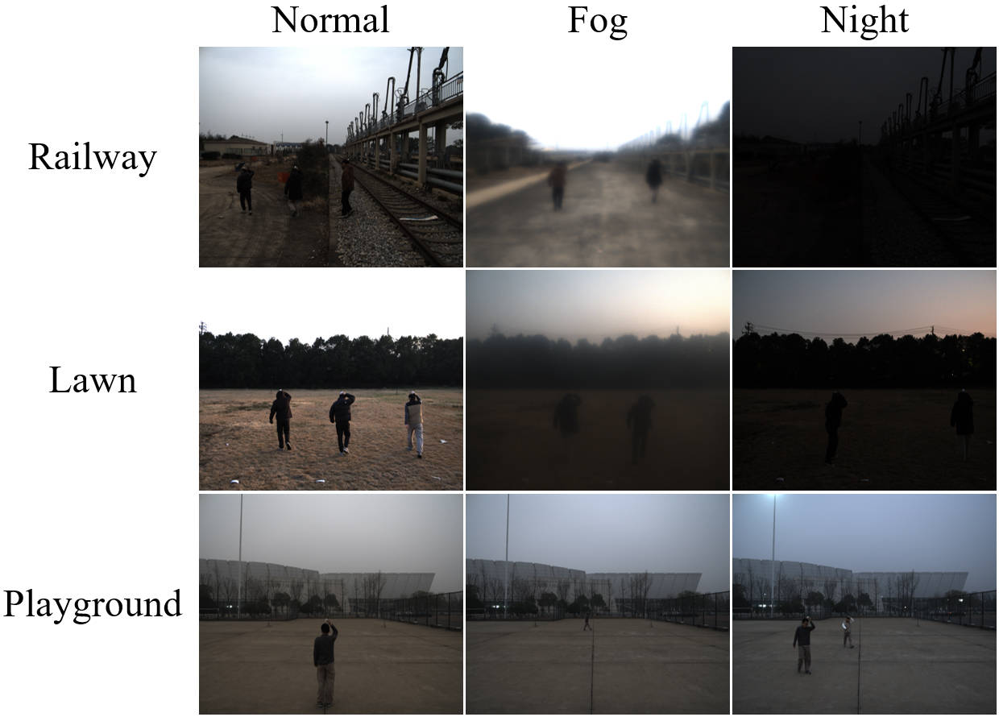
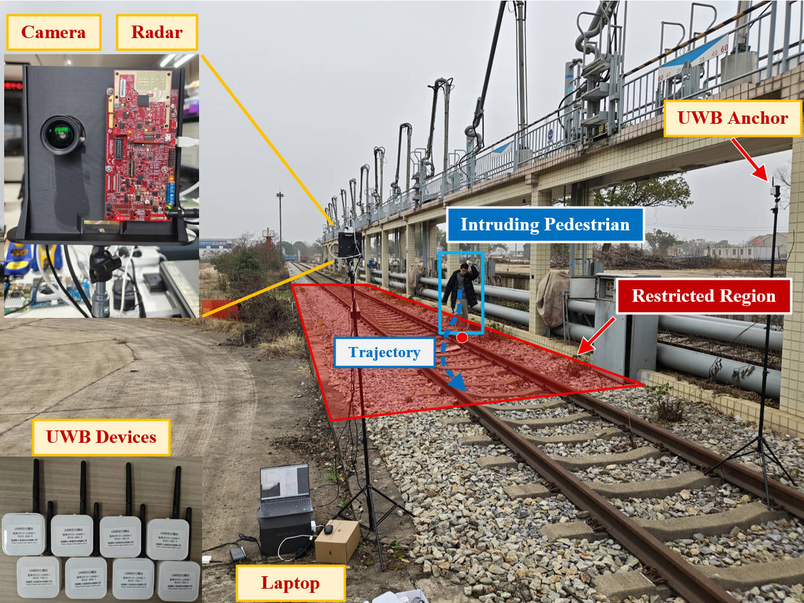
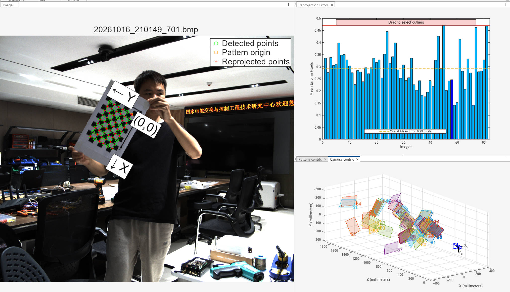
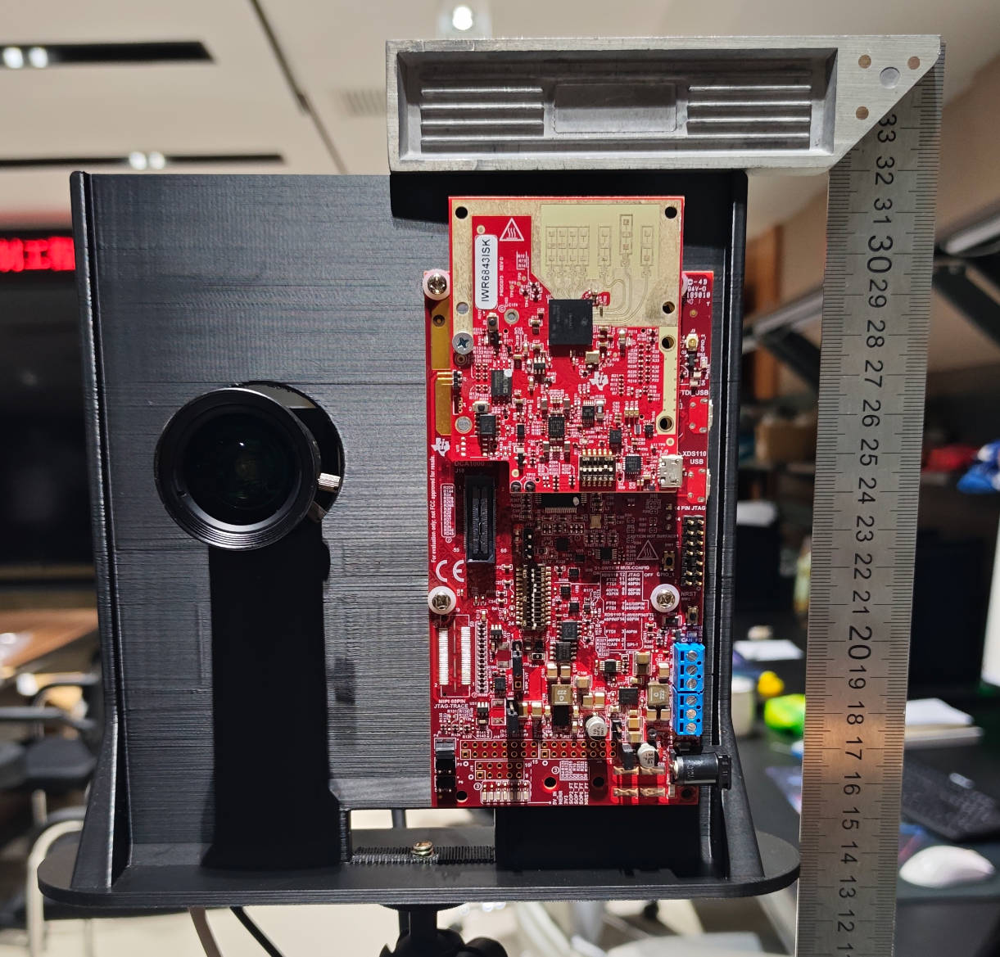
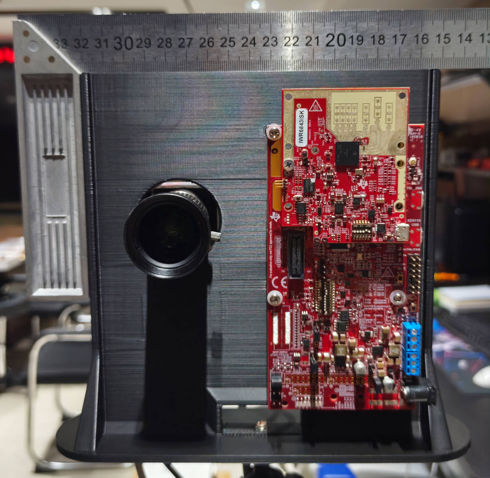

<div align="center">
<h1>RaVITD</h1>

<p><strong>Radar–Vision Intrusion Toolkit and Dataset</strong></p>

<h3>
From Image-Defined Regions to Metric Boundaries:<br>
Radar–Vision Fusion for Railway Pedestrian Intrusion Monitoring Under Degraded Visibility
</h3>
<p>
Yaoyu Jiang ,  Quan Zhou ,  Zijun Long ,  Hao Wang<br>
Xiaoguang Wei ,  Mohammad Shahidehpour
</p>
<p>
  <a href="https://github.com/ChiangJYY/Radar-Vision-Fusion">
    
  </a>
  <a href="#public-dataset-ravid--radarvision-intrusion-dataset">
    
  </a>
  <a href="mailto:yaoyujiang@hnu.edu.cn">
    
  </a>
</p>
</div>

**English** | [简体中文](docs/README_zh-CN.md)

---

## Contents

- [Overview](#overview)
- [Project Structure](#project-structure)
- [Public Source Code RaVIT](#public-source-code-ravit--radarvision-intrusion-toolkit): [Installation](#installation) · [Configuration](#configuration) · [Usage](#usage)
- [Public Dataset RaVID](#public-dataset-ravid--radarvision-intrusion-dataset)
  - [Dataset Overview](#dataset-overview) · [Data Formats](#data-formats) · [Sensors](#sensors)
  - [Spatiotemporal Alignment and Calibration](#spatiotemporal-alignment-and-calibration) · [Download and Storage](#download-and-storage) · [Evaluation Protocol](#evaluation-protocol)
- [Acknowledgments](#acknowledgments)
- [Citation](#citation)

## Overview

**RaVIT (Radar–Vision Intrusion Toolkit)** is designed for railway pedestrian intrusion monitoring under low-visibility conditions and provides **ECDR-GAT** region boundary reconstruction, **Trans-DKF** adaptive radar–vision fusion, as well as tools for data reading, calibration, multi-object tracking, region relationship determination, and evaluation.

The accompanying public dataset **RaVID (Radar–Vision Intrusion Dataset)** contains camera, radar, and UWB recordings from playground, lawn, and railway scenes, along with calibration-related files and sensor data acquisition tools. Access to the raw data can be requested by email.

## Project Structure

```text
├── src/
│   ├── radar_vision_fusion/   # Core methods, perception, calibration, tracking, and evaluation
│   └── third_party/          # Source code subsets of RT-DETR and Depth Anything V2
├── scripts/                  # Data conversion, calibration, inference, evaluation, and plotting
├── tools/                    # Sensor data acquisition tools
├── configs/                  # Inference configurations and calibration templates
├── dataset/                  # Storage location for RaVID data
├── figures/                  # Images of scenes, the camera calibration process, and equipment dimensions
├── docs/                     # Additional documentation
├── requirements.txt
└── pyproject.toml
```

## Public Source Code RaVIT — Radar–Vision Intrusion Toolkit

### Installation
The toolkit provides network architectures, feature construction, normalization interfaces, filtering formulas, loss functions, and tools for visual observations, calibration, tracking, baselines, and evaluation. Python 3.10+ is recommended. Create and activate an isolated environment in the repository root, install PyTorch and torchvision matching your local CPU/CUDA environment, and then install the project dependencies:

```bash
python -m venv .venv
# Windows PowerShell: .\.venv\Scripts\Activate.ps1
# Linux/macOS: source .venv/bin/activate
# After activation, first install PyTorch and torchvision matching your local CPU/CUDA environment.
python -m pip install -r requirements.txt
python -m pip install -e . --no-deps
```

If only the core algorithms are needed, you can directly run `python -m pip install -e .`. `requirements.txt` specifies minimum versions rather than a fixed environment; the industrial camera also requires separate installation of drivers and the Hikvision MVS SDK.

### Configuration

| Configuration or Input | Instructions |
| --- | --- |
| `configs/inference.json` | Tracking mode, noise, association, and event parameters; specify the region through `--region-file` or fill in `region` |
| `configs/calibration.template.json` | Copy to a location of your choice and enter the measured camera intrinsics and `camera_from_radar` extrinsics |
| `configs/rtdetrv2_r50vd_m.yml` | Default RT-DETRv2 architecture configuration |
| Model weights and output | Specify through parameters such as `--checkpoint` and through `--output`, respectively |

### Usage

Run from the repository root and replace the contents in angle brackets with actual paths. Users must provide the input data, region, and calibration, and specify the output location through parameters.

#### Boundary Reconstruction and Fusion Tracking

```bash
# ECDR-GAT: the boundary observation CSV columns are u,v,z_raw; the output JSON contains the four corner points of region
python scripts/run_boundary.py --input <boundary.csv> --checkpoint <ecdr.pt> --calibration <calibration.json> --output <boundary.json>

# Trans-DKF fusion tracking and boundary-crossing monitoring
python scripts/run_inference.py --input <detections.json> --region-file <boundary.json> --mode learned --checkpoint <transdkf.pt> --output <tracks.json>

# Basic tracking: learned model weights are not required; use your own region
python scripts/run_inference.py --input <detections.json> --region-file <region.json> --mode fixed --output <tracks_fixed.json>
```

#### Evaluation and Plotting

```bash
python scripts/evaluate_results.py --task boundary --prediction <boundary.json> --reference <reference_region.json> --output <boundary_metrics.json>
python scripts/evaluate_results.py --task tracking --prediction <tracks.json> --reference <reference_tracks.json> --output <tracking_metrics.json>
python scripts/plot_results.py --input <tracks.json> --output <tracking.png>
```

For evaluation, provide reference regions or trajectories; prediction and reference frame times must match. The remaining entry points are listed below:

| Script | Purpose |
| --- | --- |
| `run_visual.py` | Generate visual observations using RT-DETRv2 and metric Depth Anything V2 |
| `prepare_sequence.py` | Camera and radar data conversion and temporal alignment |
| `calibrate_extrinsics.py` | Radar–camera extrinsic calibration |
| `evaluate_results.py` | Region and tracking evaluation; reference ground truth is required |
| `plot_results.py` | Plot results |

## Public Dataset RaVID — Radar–Vision Intrusion Dataset

### Dataset Overview

RaVID provides camera images, millimeter-wave radar point clouds and device tracking outputs, and UWB logs of ground-truth pedestrian trajectories, covering single-person, multi-person, foggy, nighttime, and boundary-walking conditions in playground, lawn, and railway scenarios.

The current data package has a total size of **1.02 TB**, containing **13 condition directories and 67,864 scenario BMP images**, along with **66 camera calibration photographs**, a calibration target, and a MATLAB calibration parameter file.

<p align="center">
  
</p>

Examples of the playground, lawn, and railway sites and visibility conditions, including single-person, multi-person, foggy, nighttime, and boundary-walking conditions.

### Acquisition Platform

| Device | Configuration and Role |
| --- | --- |
| Millimeter-wave radar | Texas Instruments IWR6843, providing point clouds and observations such as target positions and velocities |
| Industrial camera | Hikrobot MV-CS050-10UC, color images, 2448 × 2048 |
| Camera lens | MVL-MF0824M-5MPE, 8 mm fixed focal length |
| Installation | The camera and radar are fixed in place approximately 2 m above the ground, with overlapping fields of view |
| UWB reference system | Five pre-calibrated base stations and positioning tags carried by pedestrians provide ground-truth pedestrian trajectories |

The acquisition frequencies of both the camera and radar are **10 Hz**, and the UWB reference positioning frequency is **5 Hz**. Each sensor's records retain timestamps, which are used to align data frames in time after acquisition;

<p align="center">
  
</p>
Illustration of the acquisition platform and intrusion monitoring in the railway scenario. The figure shows the camera, millimeter-wave radar, UWB equipment, and base station layout; the restricted area and pedestrian motion trajectories are illustrative annotations.

### Scenario Organization

The data are organized as “acquisition batch and site - condition - sensor records.” The current directory names are as follows:

| Scenario Directory | Condition Directories | Image Count |
| --- | --- | ---: |
| `0118_playground` | `single_person_normal`, `two_person_normal` | 8,838 |
| `0122_lawn` | `single_person_normal`, `two_person_normal`, `three_person_normal`, `two_person_fog`, `two_person_night` | 31,925 |
| `0129_railway` | `single_person_boundary`, `single_person_fog`, `single_person_night`, `two_person_normal`, `three_person_normal`, `two_person_fog` | 27,101 |

`single_person`, `two_person`, and `three_person` denote single-person, two-person, and three-person conditions, respectively; `normal`, `fog`, `night`, and `boundary` denote normal, foggy, nighttime, and boundary-walking conditions, respectively.

### Directory Structure

After obtaining the data, you can retain the original structure and place it under `dataset/` or use an external path. The railway single-person boundary condition is used as an example below:

```text
dataset/
├── camera_calibration/
│   ├── calibration_images/                 # Camera calibration photographs
│   ├── checkerboardPattern_side_length_23mm.pdf
│   └── matlab.mat                         # MATLAB calibration results
├── 0118_playground/
├── 0122_lawn/
└── 0129_railway/
    └── single_person_boundary/
        ├── cam/YYYYMMDD_HHMMSS/
        │   └── YYYYMMDD_HHMMSS_mmm.bmp
        ├── radar/
        │   └── LRPD_data_YYYYMMDD_HHMMSS.txt
        └── uwb/
            ├── YYYYMMDD_HHMMSSRTLS1_log.txt
            ├── YYYYMMDD_HHMMSS_RTLS1_Tag<N>_log.csv
            └── YYYYMMDD_HHMMSSRTLS_log_dbg.txt
```

`cam/` stores images, `radar/` stores point clouds and clustering and tracking results, and `uwb/` stores reference positioning and ranging logs. A condition may contain multiple acquisition sessions and multiple log files.

### Data Formats

#### Camera Images

Camera images are saved by acquisition session, with a typical path as follows:

```text
cam/YYYYMMDD_HHMMSS/YYYYMMDD_HHMMSS_mmm.bmp
```

| Item | Data Form or Value | Description |
| ------------ | ------------------------- | -------------------------------------- |
| File format | BMP | Uncompressed color images |
| Image resolution | 2448 × 2048 | Width × height, in pixels |
| Image bit depth | 24 bit | Three color channels, 8 bit per channel |
| Nominal acquisition frequency | 10 Hz | Actual intervals are determined by the image file timestamps |
| Session directory | `YYYYMMDD_HHMMSS/` | Image storage directory created for each acquisition session |
| Filename | `YYYYMMDD_HHMMSS_mmm.bmp` | Contains the image recording date, time, and millisecond component |
| `YYYYMMDD` | Year, month, day | Used to determine the recording date |
| `HHMMSS` | Hour, minute, second | Used to determine the recording time |
| `mmm` | Millisecond component | Three digits, ranging from `000–999` |
| Timestamp source | Acquisition computer's local clock | Generated by the image acquisition callback; not the hardware exposure start time |

#### Radar Logs

TXT files provide processed per-frame point clouds and device tracking results and do not contain raw ADC waveforms. The data format is as follows:

```text
Timestamp: YYYY-MM-DD HH:MM:SS.mmm, Frame: <frame number>, Points: <point count>, Tracks: <track count>
Points (X,Y,Z,Doppler,SNR,Noise,TrackIndex):
Tracks (TID,X,Y,Z,Vx,Vy,Vz,Ax,Ay,Az,G,ConfidenceLevel):
```

| Type | Fields |
| --- | --- |
| Frame header | `Timestamp: YYYY-MM-DD HH:MM:SS.mmm, Frame: <frame number>, Points: <point count>, Tracks: <track count>` |
| Points | `X,Y,Z,Doppler,SNR,Noise,TrackIndex` |
| Tracks | `TID,X,Y,Z,Vx,Vy,Vz,Ax,Ay,Az,G,ConfidenceLevel` |

**Frame Header Fields**

| Field | Meaning | Unit or Description |
| ----------- | -------------------------------- | ----------------------------------------- |
| `Timestamp` | Computer local time when the acquisition program saves the frame | Date and time recorded to milliseconds; not the radar CPU timestamp |
| `Frame` | Frame number output by the radar | Integer |
| `Points` | Number of detected points in the current frame | Count |
| `Tracks` | Number of tracked targets in the current frame | Count |

**Point Cloud Fields (Points)**

| Field | Meaning | Unit or Description |
| ------------ | ------------------------------------ | -------------- |
| `X` | X coordinate of the detected point | m |
| `Y` | Y coordinate of the detected point | m |
| `Z` | Z coordinate of the detected point | m |
| `Doppler` | Radial velocity of the detected point | m/s |
| `SNR` | Signal-to-noise ratio of the detected point | dB |
| `Noise` | Noise metric corresponding to the detected point | dB |
| `TrackIndex` | Track number associated with the detected point, or a status code indicating no association | Integer, including special values |

**Common TrackIndex Values**

| Value | Meaning |
| ------- | -------------------------------------------- |
| `0–249` | Normal track number range; the actual number available is limited by the tracking configuration |
| `253` | Signal-to-noise ratio too low; not associated with a track |
| `254` | Outside the boundary of interest; not associated with a track |
| `255` | Not associated with a track; treated as noise |

**Device Tracking Fields (Tracks)**

| Field | Meaning | Unit or Description |
| ----------------- | --------------------------------------------------- | ------------------------------------ |
| `TID` | Track number of the tracked target | Integer |
| `X` | Target X coordinate estimated by the tracker | m |
| `Y` | Target Y coordinate estimated by the tracker | m |
| `Z` | Target Z coordinate estimated by the tracker | m |
| `Vx` | Estimated target velocity along the X axis | m/s |
| `Vy` | Estimated target velocity along the Y axis | m/s |
| `Vz` | Estimated target velocity along the Z axis | m/s |
| `Ax` | Estimated target acceleration along the X axis | m/s² |
| `Ay` | Estimated target acceleration along the Y axis | m/s² |
| `Az` | Estimated target acceleration along the Z axis | m/s² |
| `G` | Association gating function gain (Gating function gain) | Dimensionless; used for gating associations between measurements and tracks |
| `ConfidenceLevel` | Confidence metric of the device tracker (Tracker confidence metric) | Dimensionless; not directly interpreted as a detection probability or percentage |

The number of records per frame varies; when both the point count and track count are zero, a frame may contain only the header. Readers should allow empty frames.

#### UWB TXT

The main UWB log (`*RTLS1_log.txt`) saves base station configurations, tag-to-base-station ranges, and tag positioning results line by line. The data format is as follows:

```text
YYYY-MM-DD_HH:MM:SS:mmm HR-RTLS1 LogFile
HH:MM:SS:mmm Anchor<m>(x_a,y_a,z_a)
HH:MM:SS:mmm TAG<n>-ANC<m>=distance
HH:MM:SS:mmm TAG<n>[x_t,y_t,z_t]
```

When positioning is invalid, the log may contain:

```text
HH:MM:SS:mmm TAG<n>[nan,nan,nan]
```

**Record Types**

| Type | Data Format | Content |
| -------- | ------------------------------------------ | ------------------------ |
| File header | `YYYY-MM-DD_HH:MM:SS:mmm HR-RTLS1 LogFile` | Log date and time and file identifier |
| Base station configuration | `HH:MM:SS:mmm Anchor<m>(x_a,y_a,z_a)` | Base station number and configured coordinates |
| Ranging record | `HH:MM:SS:mmm TAG<n>-ANC<m>=distance` | Distance from the specified tag to the specified base station |
| Positioning record | `HH:MM:SS:mmm TAG<n>[x_t,y_t,z_t]` | Position result for the specified tag |

**Reading Notes**

- This dataset interprets range values in **mm** and coordinate values in **m**; the TXT files do not append a unit suffix to each item.
- Logs may list configurations from `Anchor0` through `Anchor7`, but this does not mean that all eight base stations participate in positioning. Five base stations were used in this experiment.
- Timestamps of ranging and positioning records may differ slightly; records should be matched by tag number and time.
- Missing ranging records must not be filled directly with zero, and positioning results containing `nan` are not used as valid reference positions.
- The presence of a `z_t` field alone does not establish that it is a valid three-dimensional height measurement.

#### UWB CSV

Some records provide CSV files for individual tags, with the following main fields:

| Field | Meaning or Unit |
| --- | --- |
| `rangetime(ms)` | Time counter value in milliseconds |
| `tag_ID` | Tag identifier |
| `x(m),y(m),z(m)` | Tag position, in meters |
| `range0(m)` through `range7(m)` | Distances to the base stations, in meters; some values are `null` |
| `rx_pwr(dBm)` | Received power, dBm |
| `accel_*`, `gyro_*`, `mag_*` | Reserved inertial and magnetic field fields |
| `roll,pitch,yaw` | Reserved orientation fields |

The end of the header may contain an empty column; zero values in the reserved inertial and orientation fields must not be treated as valid measurements. `Tag1/Tag2/Tag3` in the current CSV filenames correspond to `Tag 0/Tag 1/Tag 2` in the contents.

### Sensors

#### Industrial Camera and Acquisition Tool

| Parameter | Specification |
| --- | --- |
| Camera model | Hikrobot MV-CS050-10UC, color |
| Sensor type | CMOS, global shutter |
| Sensor model | Sony IMX264 |
| Pixel size | 3.45 μm × 3.45 μm |
| Sensor format | 2/3 inch |
| Resolution | 2448 × 2048 |
| Manufacturer-specified maximum frame rate | 60 fps, limited to 2448 × 2048, Bayer RG 8 |
| Lens mount | C-Mount |

**Acquisition steps**:

1. The camera data acquisition tool we provide supports real-time image saving and visualization. First install Hikrobot MVS, the camera driver, and the Python SDK, then connect the camera. Check that `sdk_path` in `tools/camera/camera.py` points to the local SDK's `MvImport` directory. The script's current default path is `D:\MVS\MVS\Development\Samples\Python\MvImport`.
2. Open a terminal from the repository root and launch the acquisition interface:

   ```powershell
   cd tools/camera
   python .\camera.py
   ```

3. The program automatically enumerates and opens the first available camera. Click “Start” to acquire and save images; adjust the exposure through the interface.
4. Click “Stop” to pause saving while the preview continues. Clicking “Start” again creates a new recording directory.

The script defaults to **10 Hz, 2448 × 2048, and 50 ms exposure**, with exposure adjustable through the interface. Images are saved in `YYYYMMDD_HHMMSS/` under the launch directory, with filenames in the form `YYYYMMDD_HHMMSS_mmm.bmp`; timestamps come from the acquisition computer's local clock.

#### Camera Lens

| Parameter | Specification |
| --- | --- |
| Model | Hikrobot MVL-MF0824M-5MPE |
| Focal length | 8 mm, fixed focal length |
| F-number | F2.4–F16, manual iris |
| Image circle | Φ11 mm (2/3 inch) |
| TV distortion | −0.9%, manufacturer's nominal value |
| Field of view | Diagonal D: 70.6° (11.1 mm); horizontal H: 56.4° (8.45 mm); vertical V: 48.3° (7.07 mm) |
| Focus and mount | Manual focus, C-Mount |

#### Millimeter-Wave Radar and Acquisition Tool

Acquisition uses the prebuilt Long Range People Detection firmware from **TI mmWave Industrial Toolbox 4.12.1**:

```text
labs/Long_Range_People_Detection/prebuilt_binaries/long_range_people_det_6843_demo.bin
```

The example version in this toolbox is **Long Range People Detection 1.5.1**, and the 6843 project depends on **mmWave SDK 03.05.00.04**. This document cites the firmware source; the repository does not include the firmware file. The corresponding configuration is [`6843_50m_2D.cfg`](tools/radar/Visualizer/chirp_configs/6843_50m_2D.cfg).

| Parameter | Configuration value and description |
| --- | --- |
| Radar model / start frequency | IWR6843 / 60 GHz |
| Receive and transmit channels | 4 Rx; `channelCfg 15 7 0` enables 3 Tx, while the current two chirps actually use Tx masks `1` and `4` (2 Tx) |
| Frequency slope | 8.241 MHz/μs |
| ADC sampling rate / number of samples | 3433 kS/s / 125 samples |
| ADC data format | 16 bit, complex output (`adcCfg 2 1`) |
| ADC start time | 6 μs |
| Idle time / Ramp End time | 35 μs / 43 μs |
| Single-chirp period | 78 μs (35 + 43) |
| Chirp organization per frame | chirps 0–1, 128 loops, 256 chirps in total |
| Frame period / nominal frame rate | 100 ms / 10 Hz, continuous acquisition (frame count set to 0) |
| RX gain | 48 dB |
| Configured mounting position | `sensorPosition 2 0 0`: height 2 m, with azimuth and elevation both configured as 0° |

The acquisition parameters are as follows:

| Acquisition parameter | Displayed value | Unit |
| --- | ---: | --- |
| Max Range | 56.23 | m |
| Range Resolution | 0.499 | m |
| Maximum radial velocity (Max Velocity) | 8.012 | m/s |
| Velocity Resolution | 0.062 | m/s |

The values above are calculated by the Visualizer from the configuration and are not measured accuracy.


| Configuration item | Setting in cfg |
| --- | --- |
| Static clutter removal | `clutterRemoval -1 1` |
| Multi-object beamforming | `multiObjBeamForming -1 1 0.5` |
| Extended maximum velocity / BPM | `extendedMaxVelocity -1 0` / `bpmCfg -1 0 0 1`, both disabled |
| Range CFAR | `cfarCfg -1 0 2 8 4 3 0 10 0` |
| Doppler CFAR | `cfarCfg -1 1 0 4 2 3 1 10 0` |
| Angular filtering range | `aoaFovCfg -1 -90 90 -90 90` |
| Range / velocity filtering range | `cfarFovCfg -1 0 0 59.99` / `cfarFovCfg -1 1 -30 30.00` |
| Static and tracking boundaries | `staticBoundaryBox` and `boundaryBox` are both `-50 50 0.5 60 -0.5 6`, in m |
| Association thresholds | `gatingParam 4 6 6 6 10` |
| Track states / allocation rules | `stateParam 4 10 60 600 20 600` / `allocationParam 30 30 0.5 3 2 2` |
| Maximum acceleration configuration | `maxAcceleration 0.1 0.1 0.1` |
| Tracker configuration | `trackingCfg 1 2 250 20 78 121 99` |
| Presence detection region | `presenceBoundaryBox -3 3 2 6 0.5 2.5` |


**Acquisition steps**:

1. The radar data acquisition tool we provide supports online data saving and visualization. First confirm that the device has been flashed with the matching firmware specified above, connect the radar, and install the serial port driver. See `requirements.txt` for Python dependencies.
2. Open another terminal from the repository root and launch the Visualizer:

   ```powershell
   cd tools/radar/Visualizer
   python .\gui_main.py
   ```

3. Select **Long Range People Detection**, enter the port numbers for **CLI COM** and **DATA COM**, and click **Connect**.
4. Click **Select Configuration** and select `chirp_configs/6843_50m_2D.cfg`.
5. Click **Start and Send Configuration** to send the configuration and begin acquisition.
6. Click **Start Save** to save TXT files; click **Stop Save** to stop saving.

Files are saved to `data/LRPD_data_YYYYMMDD_HHMMSS.txt` under the Visualizer's launch directory and contain host-local timestamps, point clouds, and device tracks. This tool outputs processed point clouds and tracks; it does not save raw ADC waveforms.

#### UWB Positioning System and Acquisition

This dataset uses a commercial UWB positioning system in which each device can be configured as an anchor or a tag.

| Parameter | Specification and experimental setting |
| --- | --- |
| UWB core chip | DecaWave DW1000 |
| Maximum ranging distance | In open line-of-sight conditions, 150 m at 110 Kbps; 100 m at 6.8 Mbps |
| Manufacturer-specified ranging accuracy | 5 cm; |
| Frequency range | 3244–4659 MHz |
| Bandwidth | 500 MHz |
| Data update rate | Adjustable up to 100 Hz; recording rate in this experiment: 5 Hz |
| Data interface | USB-to-serial / TTL, 115200 bps, 8N1 |
| Power supply | Built-in 3.7 V lithium battery, or external DC 5 V power supply / charging |
| Experimental setup | Five precalibrated anchors, with pedestrians carrying positioning tags |

**Acquisition steps**: Connect the devices and the manufacturer's host software → manually calibrate the anchors → enter anchor coordinates and tag settings according to the measured setup → check ranging and positioning output → save RTLS TXT and available CSV logs. This project uses LD150; the reserved inertial, magnetic-field, and attitude fields in the CSV are not treated as valid IMU data.

### Spatiotemporal Alignment and Calibration

#### Spatiotemporal Alignment

This dataset uses the timestamps included in each record for offline matching throughout. Camera filenames, radar frame headers, and UWB use the acquisition computer's local time. We recommend using camera timestamps as the reference and aligning radar and UWB data frames by the closest timestamp.

| Data type | Time representation |
| --- | --- |
| Camera | Date, hours, minutes, seconds, and milliseconds in the filename |
| Radar | Full date and time in the frame header |
| UWB TXT | Date in the log header and hours, minutes, seconds, and milliseconds in each record |
| UWB CSV | `rangetime(ms)`; its internal timing origin must be checked against the corresponding records |

1. Match offline by timestamp and check time differences, missing frames, and duplicate times. Do not pair records by identical frame numbers, line numbers, or file ordering. `rangetime(ms)` is not interpreted directly as a Unix timestamp.
2. The released `scripts/prepare_sequence.py` supports one-time camera–radar frame matching and retains unmatched frames. Users set the matching tolerance according to the records.

| Coordinate system | Axis convention |
| --- | --- |
| Camera | X right, Y down, Z forward |
| Radar | X right, Y forward, Z up |
| UWB | X right, Y forward, Z up |

Spatial alignment handles camera intrinsics, radar–camera 3D extrinsics, and the UWB ground-plane transform separately; all units are standardized to meters. The calibration methods and procedures are described below.

#### Camera Intrinsic Calibration

The dataset also provides **66 original BMP calibration images** at **2448 × 2048**, allowing users to select images and recalibrate camera intrinsics and distortion in MATLAB Camera Calibrator.

| Resource path (relative to the dataset root) | Contents |
| --- | --- |
| `camera_calibration/calibration_images/` | Checkerboard calibration images captured from different positions and orientations |
| `camera_calibration/checkerboardPattern_side_length_23mm.pdf` | Checkerboard calibration target with a square side length of 23 mm |
| `camera_calibration/matlab.mat` | `cameraParams` camera calibration object exported from MATLAB |

Print the PDF at actual size and verify the square side length. Import the calibration images into MATLAB, select the checkerboard target, and enter **23 mm**. After automatic corner detection, inspect the reprojection error and pose distribution of the images, then calibrate and export the parameters.

<p align="center">
  
</p>

The figure shows the calibration interface after photographs of the provided PDF checkerboard target have been imported into MATLAB. The right side shows the reprojection error for each image and the calibration board pose distribution.

The key parameters read directly from `matlab.mat` are listed below; pixel parameters are shown to six decimal places:

| Parameter | Value | Unit or description |
| --- | --- | --- |
| Number of original calibration images | 66 | images |
| Number of images used in this calibration, `NumPatterns` | 61 | images |
| Image size, `ImageSize` | `[2048, 2448]` | MATLAB order is `[height, width]`, in pixels |
| Checkerboard square side length | 23 | mm |
| Number of calibration corners | 54 (9 × 6) | Planar grid points in `WorldPoints` |
| Horizontal focal length, `fx` | 2342.418428 | pixels |
| Vertical focal length, `fy` | 2340.672653 | pixels |
| Principal point, `cx` | 1208.230220 | pixels |
| Principal point, `cy` | 1059.734375 | pixels |
| Radial distortion, `k1` | -0.0525083094 | Dimensionless |
| Radial distortion, `k2` | -0.0001413974 | Dimensionless |
| Mean reprojection error | 0.2932 | pixels |

The intrinsic matrix corresponding to `cameraParams.Intrinsics.K` is:

```text
K = [2342.418428     0.000000  1208.230220
        0.000000  2340.672653  1059.734375
        0.000000     0.000000     1.000000]
```

#### Radar–Camera Extrinsic Calibration

The camera and radar are fixed to a bracket. The figures provide horizontal and vertical dimensional references for estimating their relative mounting position and initializing the extrinsic parameters. Using the calibrated camera intrinsics, radar and image observations are matched offline by their recorded timestamps to establish coordinate correspondences for the same targets in their common field of view.

<table>
  <tr>
    <td align="center"><br>Vertical dimension reference</td>
    <td align="center"><br>Horizontal dimension reference</td>
  </tr>
</table>

The figures help explain the camera–radar relative mounting position and dimensions and support initialization for calibration.

#### UWB Ground-Plane Alignment and Reference Trajectories

During acquisition, a common origin on the same ground plane is used to establish a shared coordinate system for UWB, the camera, and the radar. Pedestrians carry UWB tags to provide position references; boundary references are obtained by having pedestrians carrying tags walk along predefined boundaries.

### Download and Storage

RaVID is available for noncommercial research use only. Before applying, **please read the [RaVID Dataset Non-Commercial Research Use Agreement](docs/RaVID_Dataset_Non_Commercial_Research_Use_Agreement.docx). You do not need to print or sign it or submit a scanned copy. Please send an application email to [yaoyujiang@hnu.edu.cn](mailto:yaoyujiang@hnu.edu.cn), stating your real name, affiliation, research project, and intended use, and include the following statement in your application email:**

> I have read, understood, and accepted all terms of the RaVID Dataset Non-Commercial Research Use Agreement (version: 2026-10-18.1), particularly the provisions on noncommercial use, model release, privacy protection, termination of authorization, and disclaimers.

After receiving and confirming the agreement, we will provide data access instructions by email. RaVID offers the following two access methods; please indicate your choice in your application email:

1. **Online server download**: Download from the data server we have set up.
2. **Hard-drive shipment**: Obtain the data by shipping a hard drive; the hard-drive and shipping costs will be confirmed separately.

The download URL, access instructions, and hard-drive shipping arrangements are provided through email correspondence. Please retain your application email, authorization confirmation email, and the version of the agreement you accepted. The raw data are not uploaded with the code repository.

### Evaluation Protocol


| Task | Main Metrics |
| --- | --- |
| Ground-plane localization and boundary reconstruction | Position MAE and RMSE; boundary ASSD and HD95, and region IoU |
| Trajectory estimation | Labeled OSPA, position RMSE, IDF1, and trajectory coverage |
| Pedestrian–region relationships | Signed distance error and region state accuracy; boundary-crossing event Precision, Recall, F1, and timing error |

The paper uses a signed distance that is negative inside the region and positive outside, with boundary points counted as inside. Near-boundary evaluation covers reference distances with an absolute value of no more than **0.5 m**. Boundary-crossing events require the states before and after the transition to each persist for at least **3 frames**. Events are matched one-to-one by scenario and crossing direction, with a time difference of no more than **2.0 s**.


## Acknowledgments

We sincerely thank the authors of the following open-source projects:

- [RT-DETR / RT-DETRv2](https://github.com/lyuwenyu/RT-DETR)
- [Depth Anything V2](https://github.com/DepthAnything/Depth-Anything-V2)

We also thank the providers of the following vendor software and examples:

- **[Hikvision / Hikrobot MVS and Camera SDK](https://www.hikrobotics.com/cn/machinevision/service/download/?module=0)**
- **[Texas Instruments mmWave Industrial Toolbox](https://www.ti.com/tool/download/RADAR-TOOLBOX)**

## Citation

If you find our work helpful for your research, please consider citing our paper. If you encounter any problems, please contact [yaoyujiang@hnu.edu.cn](mailto:yaoyujiang@hnu.edu.cn).

```bibtex
@article{jiang2026ravitd,
  title={From Image-Defined Regions to Metric Boundaries: Radar--Vision Fusion for Railway Pedestrian Intrusion Monitoring Under Degraded Visibility},
  author={Yaoyu Jiang, Quan Zhou, Zijun Long, Hao Wang，Xiaoguang Wei, Mohammad Shahidehpour},
}
```

---
